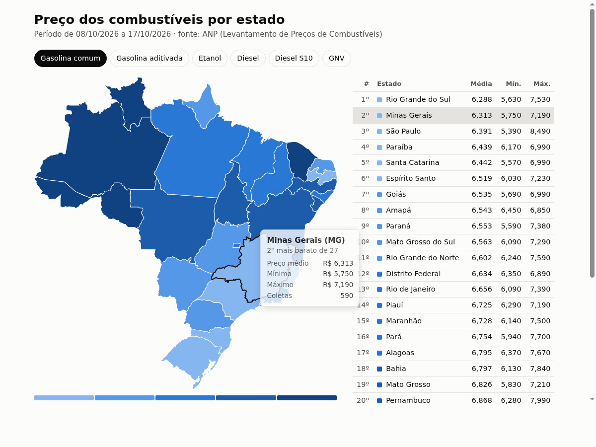
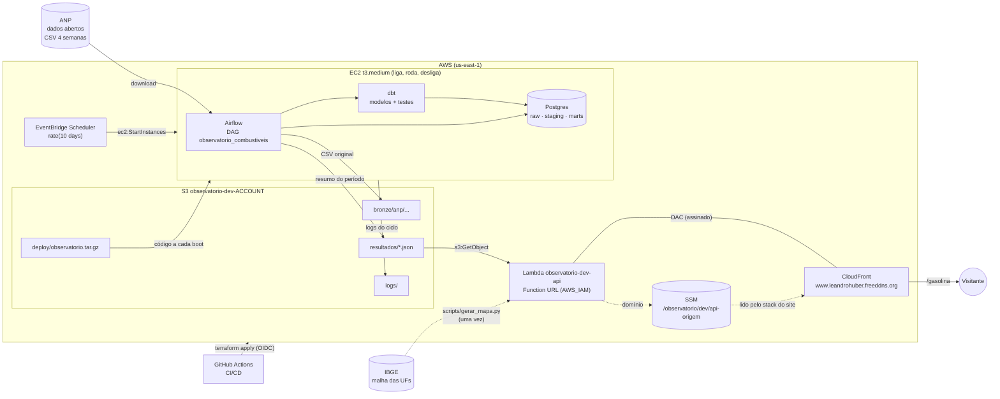
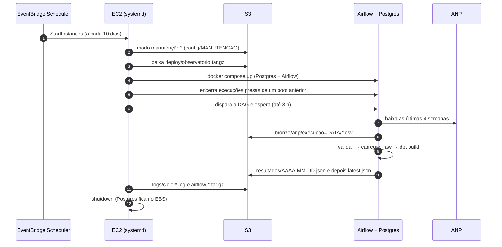
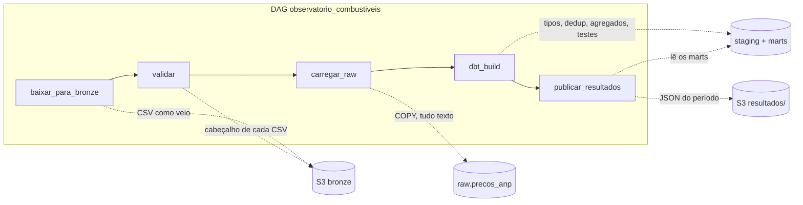
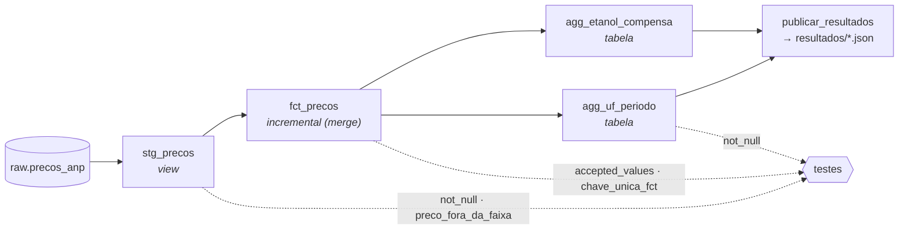
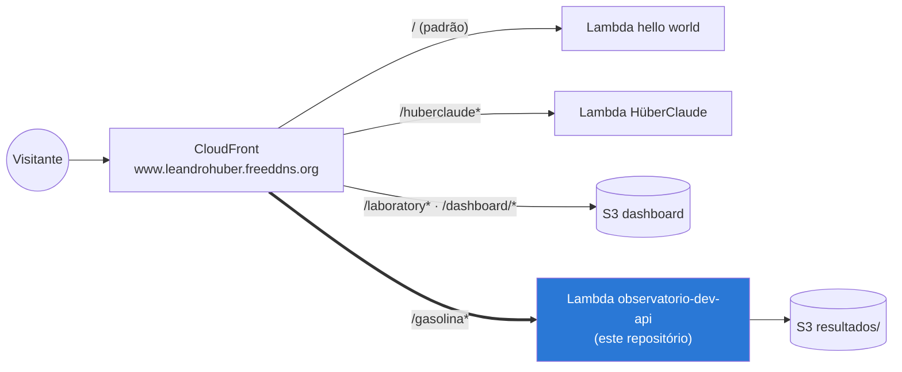
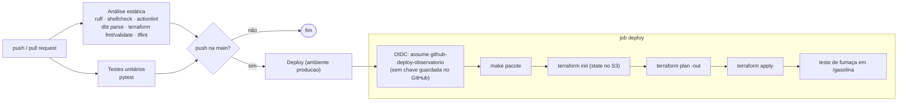
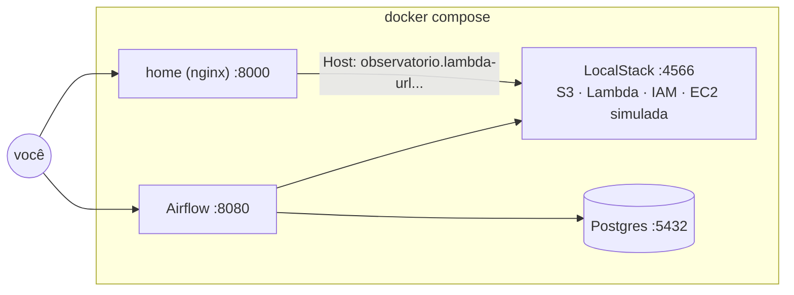
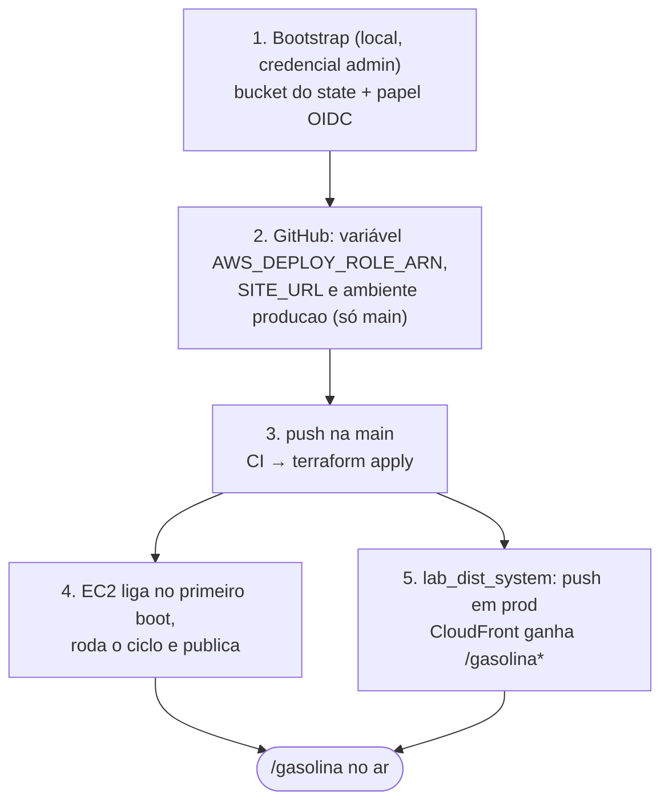

# Observatório de Preços de Combustíveis

[](https://github.com/Leandrodasilvahuber/observatorio-combustiveis/actions/workflows/ci.yml)

Pipeline de dados que coleta os preços de combustíveis da ANP (Levantamento de
Preços de Combustíveis), organiza em camadas (bronze, raw, staging, marts) e
publica a cada 10 dias um mapa do Brasil com o ranking de preço por estado.

**No ar:** <https://www.leandrohuber.freeddns.org/gasolina>



A ideia central é **pagar só pelo que roda**: a página fica sempre no ar
(Lambda + CloudFront, centavos por mês), enquanto o pipeline pesado (Postgres,
Airflow e dbt numa EC2) liga a cada 10 dias, roda uma vez e se desliga. Tudo é
desenvolvido localmente com LocalStack, e o mesmo Terraform sobe para a AWS.

## Sumário

- [Arquitetura](#arquitetura)
- [Ciclo de 10 dias na AWS](#ciclo-de-10-dias-na-aws)
- [Pipeline de dados](#pipeline-de-dados)
- [O site (/gasolina)](#o-site-gasolina)
- [CI/CD](#cicd)
- [Segurança](#segurança)
- [Custos](#custos)
- [Ambiente local](#ambiente-local)
- [Qualidade: análise estática e testes](#qualidade-análise-estática-e-testes)
- [Estrutura](#estrutura)
- [Detalhes do pipeline](#detalhes-do-pipeline)
- [API](#api)
- [Deploy na AWS](#deploy-na-aws)
- [Operação](#operação)

## Arquitetura



Quatro decisões explicam o desenho:

| Decisão | Por quê |
|---|---|
| **EC2 que liga e desliga** em vez de RDS/MWAA | Postgres e Airflow gerenciados custariam dezenas de dólares por mês para rodar 30 min a cada 10 dias. A EC2 parada custa só o disco. |
| **A Lambda nunca consulta o banco** | O banco fica desligado quase o tempo todo. O pipeline publica JSON prontos no S3 e a Lambda só lê. |
| **dbt dentro do Postgres** | As transformações e os testes de qualidade ficam versionados em SQL. Quem grava no S3 é a task `publicar_resultados`. |
| **Página sem dependências externas** | Mapa (SVG), CSS e JS saem da própria Lambda: nada de CDN nem outra requisição, e funciona com a CSP rígida do site. |

## Ciclo de 10 dias na AWS



- **Primeiro boot:** o user_data instala Docker, Compose e buildx, gera
  `/opt/observatorio/.env` com senhas aleatórias (não passam pelo Terraform
  nem pelo Git) e já roda um ciclo.
- **Atualizar o código:** cada deploy envia um novo pacote ao S3, e a EC2 usa a
  versão nova no próximo boot.
- **Proteções de custo:** qualquer falha no ciclo envia os logs e desliga; se o
  user_data falhar, a máquina desliga em 15 min; o systemd encerra o ciclo
  após 4 h.

## Pipeline de dados



Se qualquer task falhar, nada é publicado e o site segue servindo o último
período válido.

### Camadas

| Camada | Onde | Conteúdo |
|---|---|---|
| **bronze** | S3 `bronze/anp/execucao=DATA/` | CSV original da ANP, versionado pelo bucket |
| **raw** | Postgres `raw.precos_anp` | Valores exatamente como vieram, todos `text`, mais `arquivo_origem` e `carregado_em` |
| **staging** | `staging.stg_precos` (view) | Tipos, limpeza e uma linha por posto, produto e dia |
| **marts** | `marts.*` | Fato incremental e agregados do período |
| **resultados** | S3 `resultados/*.json` | Resumo do período servido pela Lambda |

### Linhagem do dbt



## O site (/gasolina)

A Lambda fica atrás da CloudFront do domínio, ao lado de outros projetos que
**não mudam**. A distribuição pertence ao stack `distributed-ecommerce-system`
(repositório [lab_dist_system](https://github.com/Leandrodasilvahuber/lab_dist_system)),
que ganhou só uma origem e um behavior para `/gasolina*`.



| Detalhe | Como fica |
|---|---|
| Autenticação da origem | Function URL com `AWS_IAM`; só esta distribuição chama (OAC + duas permissões no Terraform deste repositório) |
| Cache | `UseOriginCacheControlHeaders-QueryStrings`: respeita o `max-age=300` da Lambda e põe a query string na chave (`?formato=json` e `?periodo=` são respostas diferentes) |
| CSP do site | `script-src 'self'; style-src 'self'`: por isso CSS e JS são arquivos (`/gasolina/estilo.css`, `/gasolina/mapa.js`), e só o bloco de dados `application/json` é inline |
| Cache de CSS/JS | Os links levam um hash do conteúdo (`?v=...`), então um deploy novo aparece sem invalidação |
| Ligação entre os stacks | O Terraform publica o domínio da Function URL em `/observatorio/dev/api-origem` (SSM), que o template do site lê a cada deploy |

### O mapa

- Os estados com dados do produto são ordenados pelo preço médio e divididos em
  **cinco faixas de ranking** (do mais barato ao mais caro). A cor mostra a
  faixa, não o valor absoluto; preços empatados ficam na mesma faixa e estados
  sem coletas ficam em cinza.
- Ao passar o mouse (ou focar pelo teclado) num estado aparecem a posição no
  ranking, preço médio, mínimo, máximo e coletas. A tabela ao lado destaca o
  mesmo estado.
- Seletor de produto (gasolina comum, aditivada, etanol, diesel, diesel S10,
  GNV), tema claro e escuro, layout de celular.
- Os contornos vêm de `api/mapa_brasil.json`, gerado por `scripts/gerar_mapa.py`
  a partir da malha oficial do IBGE (equiretangular, simplificada com
  Douglas-Peucker, 32 KB).

## CI/CD



- **Workflow único** (`.github/workflows/ci.yml`): análise estática e testes em
  todo push e pull request; o deploy só roda em push na `main`, depois dos dois.
- **Sem chaves de acesso:** o GitHub Actions assume o papel
  `github-deploy-observatorio` via OIDC. O papel só aceita o ambiente
  `producao` deste repositório, e o ambiente só aceita a branch `main`.
- **Um apply por vez:** `concurrency: deploy-aws` enfileira deploys seguidos
  em vez de rodar dois no mesmo state.
- **Actions fixadas por SHA**, com a versão em comentário.
- **Ordem com o site:** na primeira vez, este repositório faz o deploy antes
  (cria a Lambda e o parâmetro SSM) e depois o `lab_dist_system` adiciona a
  rota. Depois disso os dois são independentes.

## Segurança

| Camada | Medida |
|---|---|
| Rede | EC2 sem portas de entrada; Airflow só em localhost, acessado por túnel do Session Manager |
| EC2 | IMDSv2 obrigatório (hop limit 2), EBS criptografado, senhas geradas no primeiro boot |
| IAM | Um papel por componente com privilégio mínimo: EC2 (bucket do projeto), Lambda (só `resultados/`, sem `ListBucket`), Scheduler (ligar só esta instância) |
| Lambda | Function URL com `AWS_IAM`, chamada só pela CloudFront via OAC; o código só muda via Terraform |
| CI/CD | OIDC por ambiente; papel de deploy restrito a recursos `observatorio-dev-*`, sem poder alterar a si mesmo, e políticas gerenciadas limitadas às duas que o projeto usa |
| Página | CSP do site sem inline; dados escapados para não fechar o `<script>`; texto dos dados só por `textContent` |
| State | Bucket versionado, criptografado, sem acesso público, com lock nativo do S3 |

## Custos

Estimativa mensal em us-east-1, com 3 ciclos por mês:

| Item | Uso | Custo aproximado |
|---|---|---|
| EC2 t3.medium | ~30 min por ciclo | US$ 0,07 |
| EBS gp3 30 GB | sempre (guarda o Postgres) | US$ 2,40 |
| S3 | poucos MB + requisições | < US$ 0,10 |
| Lambda + CloudFront | tráfego baixo, cache de 5 min | dentro do nível gratuito |
| **Total** | | **~US$ 2,60** |

## Ambiente local



| Serviço | Porta (host) | Observação |
|---|---|---|
| LocalStack | 4566 | S3, Lambda e cia.; os dados somem ao reiniciar o contêiner |
| Postgres | 5432 (`POSTGRES_PORT`) | bancos `observatorio` (dados) e `airflow` (metadados) |
| Airflow | 8080 | modo standalone, sem login no ambiente local |
| Home | 8000 (`HOME_PORT`) | nginx que repassa para a Lambda: o mapa em <http://localhost:8000> |

```bash
make up            # cria o .env, sobe os serviços e aplica o Terraform no LocalStack
make dag-test      # executa a DAG uma vez, em primeiro plano
make bronze-ls     # arquivos no bronze
make raw-stats     # linhas por arquivo na raw
make dbt-build     # roda só o dbt (modelos + testes)
make marts-stats   # linhas em cada camada
make resultados-ls # JSON publicados
make api-url       # URL da Lambda local
make api-test      # chama a API local
make psql          # consulta o banco
make test          # testes unitários
make lint          # análise estática
make down          # para tudo (Postgres mantém os dados)
make reset         # para tudo e apaga os volumes
```

Para imitar a AWS (rodar uma vez e derrubar): `make dag-test` e depois
`docker compose stop airflow postgres`; o LocalStack e a home continuam no ar.
`make dag-run` despausa a DAG, que passa a rodar sozinha a cada 10 dias.

Revise as senhas no `.env` (criado a partir do `.env.example`) antes da
primeira subida; elas só são aplicadas quando o volume do Postgres é criado.

### Diferenças em relação à AWS

- `make infra-local` copia `infra/localstack/localstack_override.tf` (provider
  apontando para o LocalStack, state local) e `localstack.auto.tfvars` (Lambda
  na raiz, URL pública, sem CloudFront). Os alvos `*-aws` apagam esses arquivos.
- A Function URL local tem ID fixo (tag `_custom_id_`, `API_URL_ID_LOCAL` no
  `.env`): `http://observatorio.lambda-url.us-east-1.localhost.localstack.cloud:4566/`.
- O nginx da home remove `Referer` e `Origin`: a checagem de CORS do LocalStack
  recusa (403) os arquivos da página quando eles vêm de outra origem.
- O LocalStack gratuito cria as permissões IAM mas não as aplica
  (`ENFORCE_IAM` é pago): uma permissão faltando só aparece na AWS. A EC2 é
  simulada (o user_data não roda) e o plan local sempre mostra uma alteração em
  `vpc_security_group_ids`.
- O LocalStack 4.14.0 roda sem conta; as versões `2026.x` exigem
  `LOCALSTACK_AUTH_TOKEN` e `LOCALSTACK_VERSION` no `.env`.

## Qualidade: análise estática e testes

| Ferramenta | O que verifica | Configuração |
|---|---|---|
| ruff | lint (pycodestyle, pyflakes, bugbear, pyupgrade), imports, segurança (bandit) e formatação | `ruff.toml` |
| shellcheck | scripts da EC2, do Postgres e o user_data | `make lint` |
| actionlint | sintaxe e expressões do workflow (com shellcheck nos `run:`) | CI |
| dbt parse | modelos, `ref()`, sources e YAMLs, sem conectar no banco | CI |
| terraform fmt / validate | formatação e validação das raízes `infra/bootstrap` e `infra/envs/dev` | `make lint` |
| tflint | boas práticas do Terraform e regras da AWS (tipos de instância, argumentos inválidos) | `.tflint.hcl` |
| pytest | layout da ANP, carga raw, publicação, API (rotas, prefixo, CSP, erros, escape) | `tests/` |
| testes do dbt | qualidade dos dados a cada execução (ver [dbt](#dbt)) | `dbt/` |

`make lint` e `make test` rodam o mesmo que o CI (o tflint precisa estar
instalado).

## Estrutura

```
.github/workflows/ci.yml           CI/CD: análise estática, testes e deploy
docker-compose.yml                 LocalStack, Postgres, Airflow e home (local)
docker-compose.aws.yml             Postgres + Airflow na EC2 (sem LocalStack)
airflow/                           Imagem do Airflow (dbt em venv próprio)
dags/observatorio_combustiveis.py  DAG (só orquestração)
dags/observatorio/                 Lógica do pipeline, sem dependência do Airflow
  layout.py                        Colunas da ANP -> colunas do projeto (APELIDOS)
  bronze.py                        Tasks baixar_para_bronze e validar
  raw.py                           Task carregar_raw (COPY)
  publicar.py                      Task publicar_resultados (marts -> JSON no S3)
  sql/raw_precos_anp.sql           DDL do schema raw
dbt/                               Projeto dbt (models, testes singulares, profiles)
api/handler.py                     Lambda: rotas, JSON, mapa e arquivos da página
api/pagina.html                    Página do mapa (dados entram no lugar de __DADOS__)
api/estilo.css, api/mapa.js        CSS e JS da página (servidos pela Lambda)
api/mapa_brasil.json               Contornos das UFs em SVG
scripts/gerar_mapa.py              Regera o mapa_brasil.json a partir do IBGE
ec2/ciclo.sh                       Ciclo da EC2: sobe, roda a DAG, envia logs, desliga
ec2/encerrar_execucoes_pendentes.py  Encerra execuções presas antes do disparo
postgres/init/                     Cria o banco do Airflow na primeira subida
tests/                             Testes unitários
infra/bootstrap                    Bucket do state e papel do GitHub Actions (uma vez)
infra/modules/storage              Bucket do projeto
infra/modules/api                  Lambda, Function URL, permissões da CloudFront, SSM
infra/modules/runner               EC2, papéis, Scheduler e user_data do primeiro boot
infra/envs/dev                     Ambiente dev (igual para LocalStack e AWS)
infra/localstack                   Overrides do ambiente local e template do nginx
docs/                              Imagens do README
```

## Detalhes do pipeline

### Camada raw

`raw.precos_anp` guarda os valores exatamente como vieram da ANP, todos como
`text` (CNPJ com pontuação, preço com vírgula, data em DD/MM/AAAA), mais
`arquivo_origem` (chave no bronze) e `carregado_em`. Conversões, limpeza e
deduplicação ficam na staging (dbt).

- **Colunas pelo nome:** o cabeçalho é normalizado (sem acentos, BOM e
  espaços) e mapeado por `APELIDOS` em `layout.py`. Reordenar colunas não
  quebra a carga; se a ANP renomear uma, `validar` falha listando a ausente.
- **Idempotência:** a carga apaga as linhas do mesmo `arquivo_origem` e
  insere de novo na mesma transação. Reexecutar não duplica.
- **Sobreposição:** cada execução baixa as últimas 4 semanas, então a mesma
  coleta aparece em execuções diferentes. A deduplicação é feita na staging.
- **URLs:** padrão em `config.py`; para trocar sem alterar código, crie a
  Variable `anp_urls` no Airflow com uma lista JSON de URLs.

Na raw, campos vazios ficam como `''` (texto como veio); a staging os
converte em nulos. Linhas com número de colunas diferente do cabeçalho são
carregadas e contadas em um aviso no log da task `carregar_raw`. Duas execuções
no mesmo dia gravam a mesma chave no bronze; o versionamento do bucket preserva
o arquivo anterior.

### dbt

| Modelo | Tipo | Conteúdo |
|---|---|---|
| `staging.stg_precos` | view | CNPJ só com dígitos, `numeric(10,3)`, `date`, municípios em maiúsculas, bandeira vazia vira `SEM BANDEIRA`; uma linha por posto, produto e dia (fica a carga mais recente) |
| `marts.fct_precos` | incremental (merge) | Reprocessa os últimos 35 dias e faz upsert por `cnpj, produto, data_coleta` |
| `marts.agg_uf_periodo` | tabela | Média, mínimo, máximo e coletas por UF e produto nos 10 dias mais recentes |
| `marts.agg_etanol_compensa` | tabela | Gasolina comum x etanol por município; `etanol_compensa` se a razão for ≤ 0,70 |

Testes:

- **Na staging** (rodam antes do fato incremental, então uma linha ruim para o
  build sem entrar nele): `not_null` em CNPJ, produto, UF, data e preço, e
  `preco_fora_da_faixa` (0 a 20). Data ou preço fora do formato viram nulos e
  reprovam o `not_null`, em vez de derrubar a view com erro de conversão.
- **No fato:** `not_null`, `accepted_values` (27 UFs, 6 produtos) e
  `chave_unica_fct`.
- **Nos agregados:** `not_null`.

As linhas reprovadas ficam em `dbt_falhas.<teste>` para consulta. Corrigida a
raw, o próximo build passa normalmente. Para reprocessar tudo:
`docker compose exec airflow /opt/dbt/bin/dbt build --full-refresh --project-dir /opt/airflow/dbt --profiles-dir /opt/airflow/dbt`.

## API

Na AWS as rotas ficam sob `/gasolina` (variável `BASE_PATH` da Lambda);
localmente, na raiz.

| Requisição | Resposta |
|---|---|
| `GET /gasolina` | Mapa do último período |
| `GET /gasolina?formato=json` | JSON do último período (`resultados/latest.json`) |
| `GET /gasolina?periodo=AAAA-MM-DD` | Período que termina nessa data (mapa, ou JSON com `formato=json`) |
| `GET /gasolina/estilo.css`, `/gasolina/mapa.js` | Arquivos da página |
| período em formato inválido | 400 (página HTML no mapa, JSON com `formato=json`) |
| período inexistente | 404 (idem; antes do primeiro ciclo a página avisa que ainda não há período publicado) |
| outro caminho / método | 404 / 405 |

Todas as respostas têm `Cache-Control: max-age=300` e CORS aberto. A Lambda só
pode ler `resultados/` (sem `ListBucket`: na AWS um período inexistente chega
como `AccessDenied`, que o handler responde como 404). A conta tem cota de 10
execuções concorrentes, que não permite reservar concorrência
(`api_reserved_concurrency = -1`); o cache da CloudFront segura o volume.

O JSON publicado:

```json
{
  "periodo": {"inicio": "2026-10-08", "fim": "2026-10-17", "dias": 10},
  "gerado_em": "2026-10-22T13:48:30+00:00",
  "preco_medio_por_uf": [
    {"uf": "SP", "produto": "GASOLINA", "unidade": "R$ / litro",
     "preco_medio": 6.391, "preco_min": 5.39, "preco_max": 8.49, "coletas": 1462}
  ],
  "etanol_vs_gasolina": {
    "municipios_analisados": 399,
    "municipios_onde_etanol_compensa": 239,
    "melhores_para_etanol": [
      {"uf": "SP", "municipio": "ADAMANTINA", "gasolina": 6.363, "etanol": 3.449,
       "razao": 0.542, "etanol_compensa": true}
    ]
  }
}
```

`publicar_resultados` grava primeiro `resultados/<fim>.json` e só depois o
`latest.json`, para o `latest` nunca apontar para um período inexistente. A
janela mudou de 16 para 10 dias em outubro de 2026; arquivos antigos não têm
`dias` e cobrem 16.

## Deploy na AWS

### Primeira vez



1. **Bootstrap** (uma vez, com credencial administrativa):

   ```bash
   # O backend aponta para o bucket que este passo cria: a 1ª vez sobe com
   # state local (override temporário) e depois migra para o bucket.
   printf 'terraform {\n  backend "local" {}\n}\n' > infra/bootstrap/backend_override.tf
   terraform -chdir=infra/bootstrap init
   terraform -chdir=infra/bootstrap apply
   rm infra/bootstrap/backend_override.tf
   terraform -chdir=infra/bootstrap init -migrate-state
   terraform -chdir=infra/bootstrap output deploy_role_arn
   ```

2. **GitHub:** variáveis do repositório `AWS_DEPLOY_ROLE_ARN` (output acima) e
   `SITE_URL` (`https://www.leandrohuber.freeddns.org`), e o ambiente
   `producao` restrito à branch `main`.
3. **Push na `main`:** o CI roda a análise estática e os testes e depois o
   `terraform apply`. A EC2 liga, roda o primeiro ciclo (cerca de 10 min, com
   a instalação) e desliga sozinha.
4. **Rota no site:** push em `prod` no `lab_dist_system`, que lê o parâmetro
   SSM e adiciona `/gasolina*` à CloudFront.

A conta precisa da VPC padrão (ou informe `subnet_id`). Atenção: no dev o
bucket tem `force_destroy`, então `make destroy-aws` apaga também o bronze e o
histórico de resultados.

### Depois

Qualquer push na `main` faz o deploy. Pela máquina local também funciona
(`make plan-aws` / `make deploy-aws`, com `AWS_PROFILE` no `.env`), usando o
mesmo state no S3.

## Operação

| Situação | O que fazer |
|---|---|
| Rodar fora da agenda | `make aws-ligar` (roda um ciclo e desliga) |
| Ver o último ciclo | `make aws-ultimo-log`; logs das tasks em `logs/airflow-*.tar.gz` |
| Execução falhou | `make aws-manutencao`, `make aws-ligar`, `make aws-tunel` (Airflow em localhost:8080), corrigir, reexecutar a DAG, `make aws-fim-manutencao` e desligar com `sudo shutdown -h now` via `make aws-shell` |
| ANP mudou as URLs | Variable `anp_urls` no Airflow (lista JSON), sem alterar código |
| ANP mudou o layout | A task `validar` lista as colunas ausentes; ajustar `APELIDOS` em `layout.py` |
| Teste do dbt reprovado | Linhas em `dbt_falhas.<teste>`; o site segue com o último período bom |
| Reprocessar tudo | `dbt build --full-refresh` dentro do contêiner do Airflow |
| Mexer na EC2 | Ativar a manutenção antes de qualquer reboot e desativar ao terminar |
| Regerar o mapa | `python scripts/gerar_mapa.py` (só se mudar a malha ou a simplificação) |

O modo manutenção pode ser ativado pelo arquivo `/opt/observatorio/MANUTENCAO`
na instância ou pelo objeto `s3://BUCKET/config/MANUTENCAO` (o
`make aws-manutencao` usa este, que funciona com a máquina desligada). Com ele
ativo, a EC2 liga e não roda nem desliga.
